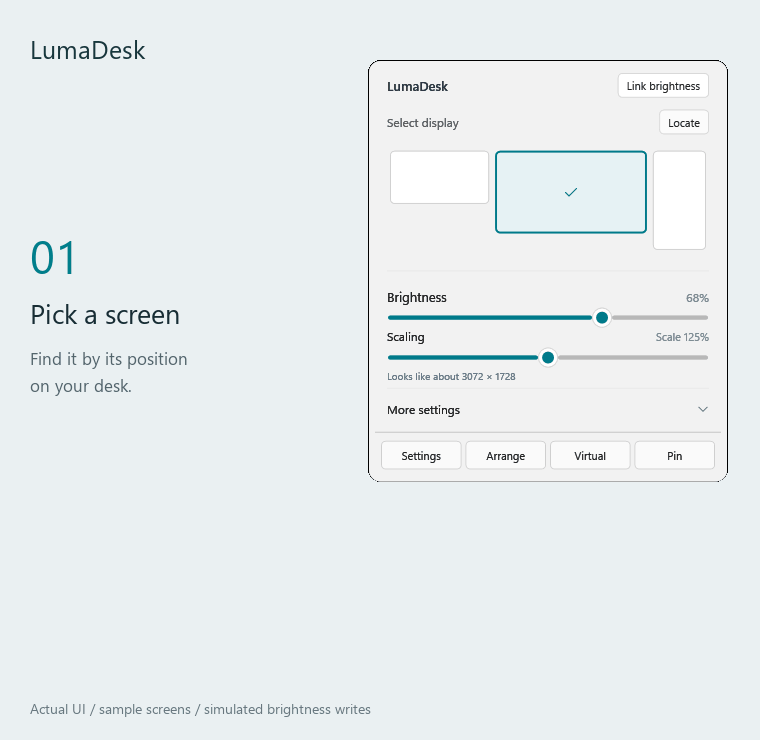
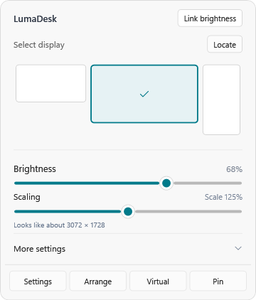
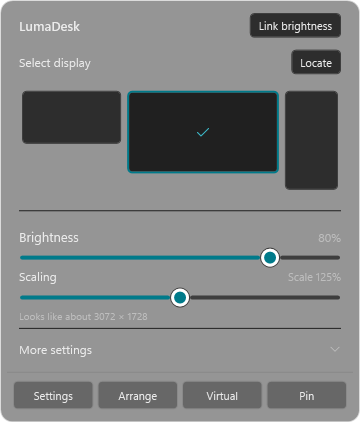
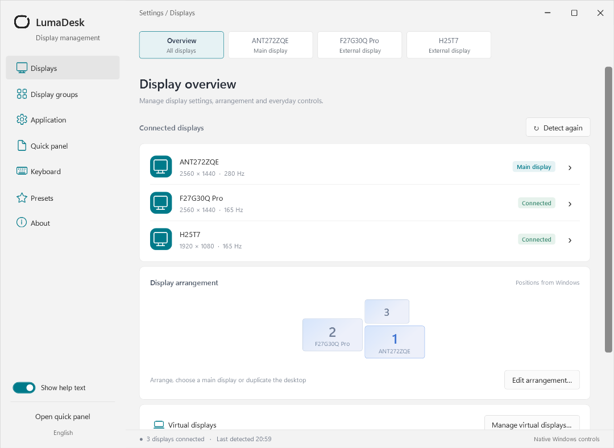

# LumaDesk

[简体中文](README.md) · English

**Every screen, one small tray panel.**

LumaDesk is an open-source Windows display manager. Adjust brightness, change scaling and switch screen setups without digging through system settings.

[Download preview](https://github.com/Thweki/LumaDesk/releases) · [Report an issue](https://github.com/Thweki/LumaDesk/issues) · [Build status](https://github.com/Thweki/LumaDesk/actions/workflows/build.yml)

## See it in action

Pick a screen by its position, open more settings, then adjust several screens together.



*Rendered from the actual WPF interface with sample displays and simulated brightness callbacks. This does not show hardware response times.*

<p>
  
  
</p>

## What you can do

- **Get brightness right:** combine backlight control and software dimming, adjust one screen, select several or sync a group.
- **Control each screen:** scaling, resolution, refresh rate and rotation, plus inputs, volume and contrast where supported.
- **Keep your setup handy:** arrange displays, choose the main screen, extend or mirror, and save setups as one-click presets.
- **Go a little further:** HDR, ICC profiles, virtual displays and picture in picture.
- **Make it yours:** keyboard shortcuts, optional startup, light/dark themes, and Simplified Chinese, Traditional Chinese, English, Japanese and Korean.



## Download and get started

For **Windows 10 / 11 x64**. The .NET runtime is included. Choose a file from [Releases](https://github.com/Thweki/LumaDesk/releases):

| File | Use it to… |
| --- | --- |
| `LumaDesk-VERSION-win-x64.exe` | Run directly, without installing |
| `LumaDesk-VERSION-portable-win-x64.zip` | Get the app with its documentation and licenses; extract and run |
| `LumaDesk-VERSION-win-x64.msi` | Install to Program Files with a Start menu shortcut (administrator access required) |

1. Run `LumaDesk.exe`. Click the tray icon for the panel; double-click for settings.
2. Pick a screen at the top and drag brightness or HiDPI. Use **Link brightness** to adjust several screens.
3. Save your setup under **Settings → Presets**. Startup and language options live under **Settings → Application**.

Default shortcuts: `Ctrl+Alt+↑ / ↓` adjusts the screen under the pointer; `Ctrl+Alt+0` removes software dimming.

All editions store settings in `%LOCALAPPDATA%\LumaDesk`. “Portable” means no installation, not settings beside the executable. There is no telemetry. The virtual driver downloads only when you choose to install it. Driver installation and first-time system ICC imports may request administrator approval.

## Before you download

- HiDPI uses Windows per-display scaling, not full-desktop supersampling. Some older apps may still look blurry.
- DDC/CI, HDR, ICC and input switching depend on your monitor, connection and driver. Acrylic requires Windows 11 22H2 or later.
- Virtual displays require the separately installed [VirtualDrivers driver](https://github.com/VirtualDrivers/Virtual-Display-Driver).
- This is still a preview. Hardware compatibility is being tested; include your monitor model and connection when reporting an issue. See the [validation notes](docs/validation.md).

## Build it yourself

Windows and the .NET 8 SDK are required.

```powershell
.\build.ps1 -Portable  # Self-contained EXE
.\test.ps1             # Full suite; requires an interactive desktop
.\package.ps1          # EXE, portable ZIP, MSI and SHA256SUMS.txt
```

App output: `artifacts/LumaDesk-win-x64/`. Release files: `artifacts/release/`. GitHub Actions runs headless tests, packaging and installation checks for pushes and PRs, and publishes version tags. See [release instructions](docs/releasing.md).

More: [Presets and automation](docs/workflows.md) · [HDR / ICC](docs/color-hdr.md) · [Display layout](docs/display-layout.md) · [Virtual displays](docs/virtual-displays.md) · [Translations](docs/localization.md)

## License

Version 0.4.0 onward: [GPL-3.0-only](LICENSE). Versions through 0.3.1 retain their original MIT license. Third-party components keep their own licenses; see [NOTICE](NOTICE).
