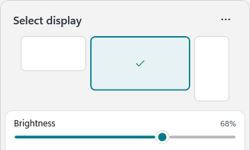
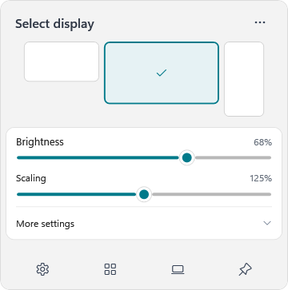
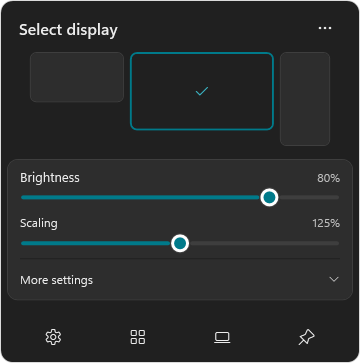
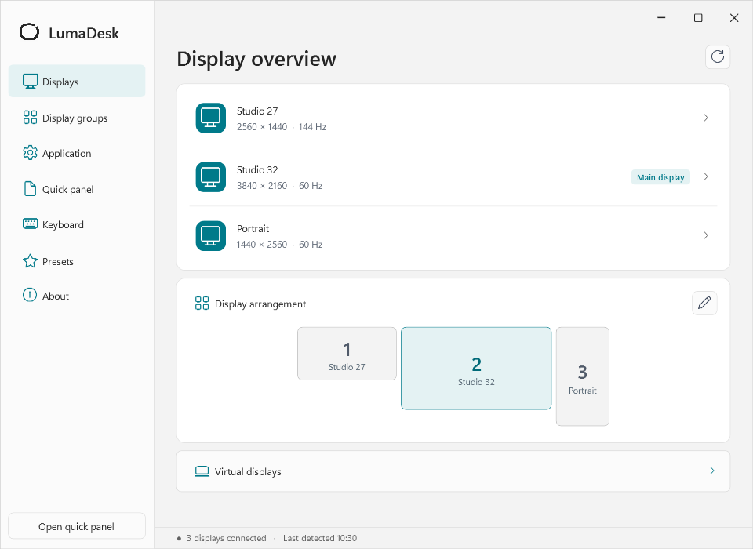

# LumaDesk

[简体中文](README.md) · English

**Every screen, one small tray panel.**

LumaDesk is an open-source Windows display manager. Adjust brightness, change scaling and switch screen setups without digging through system settings.

[Download preview](https://github.com/Thweki/LumaDesk/releases) · [Report an issue](https://github.com/Thweki/LumaDesk/issues) · [Build status](https://github.com/Thweki/LumaDesk/actions/workflows/build.yml)

## See it in action

Select a display by its position and drag the brightness slider. To adjust several displays together, open **⋯** and choose **Link brightness**.



<p>
  
  
</p>

## What you can do

- **Get brightness right:** combine backlight control and software dimming, adjust one screen, select several or sync a group.
- **Control each screen:** scaling, resolution, refresh rate and rotation, plus inputs, volume and contrast where supported. [Windows connection labels](docs/input-connection.md) show recognized connector types even when DDC input detection is unavailable.
  In the tray panel, select a screen and use **− / +** beside Scaling to move one supported step: **+** makes text larger, **−** makes it smaller. Changes apply immediately; buttons stop at the display's limits and are unavailable with unsupported/custom scaling.
- **Keep your setup handy:** arrange displays, choose the main screen, extend or mirror, and save setups as one-click presets.
- **Take back an adjustment:** undo the last applied preset, resolution, refresh rate, rotation or scaling change from the Presets menu.
- **Go a little further:** HDR, ICC profiles, virtual displays and picture in picture.
- **Optional experiment:** [overscan and underscan](docs/overscan.md) on monitors that expose scan-mode control; disabled by default.
- **Make it yours:** keyboard shortcuts, optional startup, light/dark themes, and Simplified Chinese, Traditional Chinese, English, Japanese and Korean.



## Download and get started

For **Windows 10 / 11 x64**. A slim EXE is available starting with v0.6.0. Choose a download from [Releases](https://github.com/Thweki/LumaDesk/releases).

| File | Use it to… |
| --- | --- |
| `LumaDesk-VERSION-win-x64.exe` | Run directly with the bundled .NET runtime |
| `LumaDesk-VERSION-slim-win-x64.exe` | Get the smallest download if the x64 .NET 8 Desktop Runtime is already installed |
| `LumaDesk-VERSION-portable-win-x64.zip` | Get the app with its documentation and licenses; extract and run |
| `LumaDesk-VERSION-win-x64.msi` | Install to Program Files with a Start menu shortcut (administrator access required) |

1. Run `LumaDesk.exe`. Click the tray icon for the panel; double-click for settings.
2. Select a display and drag the brightness or scaling slider. Open **⋯** in the upper-right corner to link brightness, locate a display, or move the panel to the selected display.
   The panel stays on that display until you close it or the display disconnects. Reopening the panel brings it back to the tray display.
   Under **More → Monitor volume**, use **−5 / +5** to adjust only the selected monitor in five-percentage-point steps (0–100%). These controls appear when Windows exposes monitor volume through DDC/CI; they do not change Windows master volume.
   Choose **Show display list** for numbered, named screens in your saved panel order. Reorder them under **Settings → Quick panel → More options → Move up / Move down**; this never changes desktop positions. **Show display map** returns to the spatial view. The chosen view is remembered; new profiles start with the map. Both views support **Link brightness**.
3. Save your setup under **Settings → Presets**. To start LumaDesk in the tray when you sign in to Windows, enable the startup option under **Settings → Application**.
4. **Automatic updates** under **Settings → Application** is off by default. Enable it to download new GitHub releases, including previews. LumaDesk verifies the SHA-256 digest and installs the update when you quit. Turning the option off cancels a pending update. MSI upgrades may prompt for administrator approval.

After applying a preset, open a screen in **Settings → Displays → Reset to preset** to restore its brightness, scaling, rotation, or all available saved controls. The reset target is the last preset successfully applied to that screen during this session. [Reset behavior and limits](docs/workflows.md#reset-one-display-to-its-preset).

Default shortcuts: `Ctrl+Alt+↑ / ↓` adjusts the screen under the pointer; `Ctrl+Alt+0` removes software dimming.

**Experimental idle dimming (off by default):** enable **Settings → Application → Idle dimming (experimental)** and choose an idle delay of 1–60 minutes (default: 5). LumaDesk temporarily shades all screens after no keyboard or mouse input; activity restores the prior shade on the next check (about half a second). This uses a software overlay, leaves monitor backlights and saved brightness untouched, and preserves screens already dimmed more deeply. See [behavior and limitations](docs/workflows.md#experimental-idle-dimming).

To inspect a preset before switching, enable **Application → Preset comparison (experimental)**, then use **Presets → More options → Compare with current setup**. This read-only comparison defaults off; see [preset comparison](docs/workflows.md#experimental-preset-comparison).

**Experimental brightness easing (default OFF):** launch with `LUMADESK_EXPERIMENTAL_TRANSITIONS=1` for a short ease when manually adjusting brightness. See [usage and validation](docs/brightness-transitions.md).

Optional preview: [keep displays awake while the tray panel is open](docs/keep-awake.md), behind an experimental flag that defaults off.

All editions store settings in `%LOCALAPPDATA%\LumaDesk`. “Portable” means no installation, not settings beside the executable. There is no telemetry. The virtual driver downloads only when you choose to install it. Driver installation and first-time system ICC imports may request administrator approval.

## Before you download

- HiDPI uses Windows per-display scaling, not full-desktop supersampling. Some older apps may still look blurry.
- DDC/CI, HDR, ICC and input switching depend on your monitor, connection and driver. Acrylic requires Windows 11 22H2 or later.
- Virtual displays require the separately installed [VirtualDrivers driver](https://github.com/VirtualDrivers/Virtual-Display-Driver).
- This is still a preview. Hardware compatibility is being tested; include your monitor model and connection when reporting an issue. See the [validation notes](docs/validation.md).

## Build it yourself

Windows and the .NET 8 SDK are required.

```powershell
.\build.ps1 -Portable  # Single EXE with the .NET runtime bundled and compressed
.\build.ps1 -Slim      # Small single EXE, requires the x64 .NET 8 Desktop Runtime
.\test.ps1             # Full suite; requires an interactive desktop
.\package.ps1          # Both EXEs, portable ZIP, MSI and SHA256SUMS.txt
```

The portable build goes to `artifacts/LumaDesk-win-x64/`, the slim build to `artifacts/LumaDesk-slim-win-x64/`, and release files to `artifacts/release/`. GitHub Actions runs headless tests, packaging and installation checks for pushes and PRs, and publishes version tags. See [release instructions](docs/releasing.md).

More: [Presets and automation](docs/workflows.md) · [HDR / ICC](docs/color-hdr.md) · [Display layout](docs/display-layout.md) · [Virtual displays](docs/virtual-displays.md) · [Translations](docs/localization.md)

### Experimental night window

Under **Settings → Application → Night window (experimental)**, set different start/end times in local 24-hour `HH:mm` format, click **Apply window**, then enable the toggle. It defaults **off**, with a suggested window of **21:00–07:00**. While LumaDesk runs, the window applies at least 35% software shading to all connected screens, preserving any stronger manual shading. It does not change hardware brightness, slider values, presets or remembered brightness.

The window is checked at startup, after display refresh, and approximately every 20 seconds. Overnight windows are supported; starting or resuming inside a window activates it, and leaving the window restores the current manual shading. **Reset dimming** (`Ctrl+Alt+0` by default) clears shading and suspends the current window. The next daily window, editing the schedule, toggling it off/on, or restarting the app enables it again. Turning the feature off removes its shading immediately. This is clock-based shading, independent of activity or inactivity; it does not schedule monitor power-off.
Optional experiment: [save and restore per-display gamma ramps in presets](docs/workflows.md#gamma-预设实验性--gamma-presets-experimental), disabled by default (`LUMADESK_EXPERIMENTAL_GAMMA=1`).
Optional experiment: [inspect fractional refresh timing and Windows DRR status](docs/refresh-timing.md) (disabled by default).

Optional experiment: [compact tray display picker](docs/tray-compact.md) for large display setups (disabled by default).

## License

Version 0.4.0 onward: [GPL-3.0-only](LICENSE). Versions through 0.3.1 retain their original MIT license. Third-party components keep their own licenses; see [NOTICE](NOTICE).
