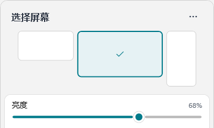

# LumaDesk · Windows 多显示器亮度与布局管理

Control external monitor brightness from the Windows system tray. [English guide & downloads](README.en.md)

想一起调暗两块外接屏，或只调亮鼠标所在的那一块？LumaDesk 是一款开源工具，把亮度滑杆放进 Windows 系统托盘。你也可以把每块屏幕的亮度、缩放和排列存成预设，在办公和夜间配置之间切换。



## 选哪个下载文件？

适用于 Windows 10 / 11 x64。[0.6.0 发布说明](https://github.com/Thweki/LumaDesk/releases/tag/v0.6.0)

| 使用场景 | 下载文件 | 打开方式 |
| --- | --- | --- |
| 直接运行，免安装 | [独立 EXE](https://github.com/Thweki/LumaDesk/releases/download/v0.6.0/LumaDesk-0.6.0-win-x64.exe) | 自带 .NET 运行时，下载后双击 |
| 电脑已有 x64 .NET 8 桌面运行时 | [轻量 EXE](https://github.com/Thweki/LumaDesk/releases/download/v0.6.0/LumaDesk-0.6.0-slim-win-x64.exe) | 下载体积最小，双击运行 |
| 想把程序和说明文档放在一起 | [便携 ZIP](https://github.com/Thweki/LumaDesk/releases/download/v0.6.0/LumaDesk-0.6.0-portable-win-x64.zip) | 解压整个文件夹，运行其中的 `LumaDesk.exe` |
| 想从开始菜单启动，或通过系统设置卸载 | [MSI 安装包](https://github.com/Thweki/LumaDesk/releases/download/v0.6.0/LumaDesk-0.6.0-win-x64.msi) | 运行安装程序，需要管理员权限 |

四种版本共用 `%LOCALAPPDATA%\LumaDesk` 中的设置和预设。0.6.0 的 EXE 和 MSI 均未签名，下载后可用发布页提供的 [SHA-256 校验值](https://github.com/Thweki/LumaDesk/releases/download/v0.6.0/SHA256SUMS.txt) 核对文件。

## 第一次使用

1. **调一块屏幕。** 首次运行会打开快捷面板。在布局图上点选显示器，拖动亮度滑杆。以后单击任务栏时钟旁的 LumaDesk 图标即可再打开，图标也可能收在 **∧** 里。屏幕较多时，可在 **⋯ → 显示屏幕列表** 中按名称选屏。
2. **一起调几块屏幕。** 打开 **⋯ → 联调亮度**，勾选要调整的屏幕，再拖动滑杆。所选屏幕会设为同一个目标亮度。
3. **保存桌面配置。** 双击托盘图标打开设置，在 **预设 → 保存当前设置** 中保存。比如给办公桌上的两块屏幕存一套白天配置和一套夜间配置，之后可直接从快捷面板切换。[预设与自动化](docs/workflows.md)

默认快捷键跟随鼠标所在的屏幕。`Ctrl+Alt+↑` 和 `Ctrl+Alt+↓` 调整亮度；`Ctrl+Alt+0` 清除所有屏幕的软件调暗。

### 外接显示器只变暗，背光没变？

先试试把滑杆从 50% 调到 80%。低于 20% 时，背光通常已经降到最低，LumaDesk 会用软件继续调暗。如果在较高亮度下背光也没变化，用显示器的实体按键打开菜单，确认 **DDC/CI** 已开启（如果有此选项）。接了扩展坞、转接器或 KVM 时，可以直连电脑再试。LumaDesk 在读不到硬件背光接口时会全程使用软件调暗。[反馈显示器兼容问题](https://github.com/Thweki/LumaDesk/issues/new?template=display-compatibility.yml)

## 开机自启和自动更新

两个开关都在 **设置 → 应用**，可以单独开启。如果你使用早期的 0.6.0，重新下载对应文件即可获得自动更新开关。

- **开机自启**会在当前用户登录 Windows 后启动 LumaDesk，并驻留系统托盘。
- **自动更新默认关闭。** 开启后，LumaDesk 会检查 GitHub 上的新版本（包括预览版），并在运行期间每天复查。下载通过 SHA-256 校验后，右键托盘图标，选择 **退出 LumaDesk** 即可安装。退出前关闭自动更新会取消待安装的更新。MSI 升级时可能需要管理员确认。

界面支持简体中文、繁体中文、英语、日语和韩语。可在同一页切换语言和深浅主题。

## 显示器还能怎么调？

| 任务 | 可用操作 |
| --- | --- |
| 调整桌面布局 | 拖动屏幕、设置主屏、扩展或复制桌面。要让两块屏幕精确对齐，可指定参照屏和相对位置。[屏幕排列](docs/display-layout.md) |
| 调整画面和字号 | 按屏设置分辨率、刷新率、旋转和 Windows 缩放。HDR 和 ICC 配置取决于 Windows、显卡驱动和显示器的支持。[HDR 与色彩管理](docs/color-hdr.md) |
| 控制外接显示器 | 在支持 DDC/CI 的设备上调节背光、对比度、显示器音量或切换输入源。可用项目随型号和连接方式而异。[硬件验证记录](docs/validation.md) |
| 添加虚拟屏幕 | 在应用内按需下载并安装 VirtualDrivers 驱动，再选择虚拟屏幕数量。首次安装需要管理员权限。[虚拟屏幕](docs/virtual-displays.md) |

### 实验性夜间时段

如果希望屏幕每天定时变暗，可在 **设置 → 应用 → 夜间时段（实验性）** 填写本地起止时间，点击 **应用时段** 后开启。默认关闭，支持跨午夜。时段内会施加至少 35% 的软件调暗，已有更深的调暗会保留。时段结束时恢复手动调暗水平。`Ctrl+Alt+0` 可以提前清除调暗并暂停本次时段。

## 从源码构建

在 Windows 上安装 .NET 8 SDK，然后从仓库根目录运行所需命令。

```powershell
.\build.ps1 -Portable   # 构建自带运行时的单文件 EXE
.\build.ps1 -Slim       # 构建轻量 EXE
.\test.ps1 -Headless    # 运行无头测试
.\package.ps1           # 在 artifacts/release/ 生成四个发布包和校验清单
```

遇到硬件问题时，请在反馈中注明显示器型号、连接方式，以及在哪一步观察到了什么现象。[反馈问题](https://github.com/Thweki/LumaDesk/issues) · [构建状态](https://github.com/Thweki/LumaDesk/actions/workflows/build.yml) · [发布流程](docs/releasing.md)

LumaDesk 从 0.4.0 起使用 GPL-3.0-only 许可，0.3.1 及更早版本沿用 MIT 许可。第三方组件按各自许可分发。[LICENSE](LICENSE) · [NOTICE](NOTICE)
