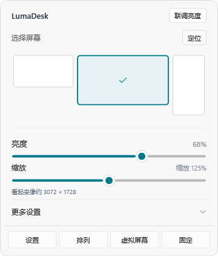

# LumaDesk

开源 Windows 显示管理工具，采用独立的 Windows 11 风格界面。常用控制直接在托盘快捷面板完成，无需跳转 Windows 设置。



## 功能

- **紧凑面板**：圆角、Windows 11 Desktop Acrylic 磨砂背景，点击外部或按 Escape 关闭。系统关闭透明效果或接口不可用时回退实色。
- **稳定定位**：缩放变化后保持原屏幕右下角停靠，使用实际工作区坐标；高缩放时自动限制面板大小，避免越出屏幕。
- **实时调整**：亮度和 HiDPI 在拖动中提交，慢请求串行处理并只保留最新目标；缩放不再等待松手，也不在每个档位重新扫描全部 DDC 硬件。
- **组合亮度**：背光与软件调暗衔接；独立背光和调暗子滑块保留在更多选项中。没有背光接口的屏幕使用软件调暗。
- **逐屏控制**：分辨率、刷新率、旋转、DDC/CI 对比度与音量，按设备能力启用。
- **HDR/ICC**：应用内切换 HDR，查看颜色状态，导入 ICC/ICM，分别设置 SDR/HDR 默认配置，恢复系统配置。
- **屏幕排列**：拖动、边缘吸附、像素坐标、主屏选择、横向/纵向排列、扩展/复制桌面。
- **虚拟屏幕**：应用内下载和安装官方签名的 VirtualDrivers 驱动，管理 0–8 台屏幕。归零停用驱动，再次添加时启用。
- **日常工具**：开机自启、画中画、亮度同步、亮度预设、快捷键、EDID 和诊断导出。

## 使用

从 [Releases](https://github.com/Thweki/LumaDesk/releases) 下载 x64 便携版，解压运行 `LumaDesk.exe`。自带 .NET 运行时。

1. 单击托盘图标打开快捷面板；双击打开完整设置。
2. 拖动亮度或 HiDPI 立即调整；右移 HiDPI 滑块增加桌面空间。
3. 展开设备底部箭头，使用模式、刷新率、音量、子滑块和“色彩与 HDR”。
4. 底部“排列”“虚拟屏幕”打开应用内管理窗口。
5. “设置 → 应用 → 开机自启”控制当前用户登录后的托盘启动，默认关闭。

安装虚拟驱动、启停驱动或首次安装系统级 ICC 文件时，Windows 可能要求管理员授权。普通显示控制不要求管理员权限。

`Ctrl+Alt+↑/↓` 调整当前选中屏幕的组合亮度，`Ctrl+Alt+0` 移除软件调暗。可在键盘设置中关闭。

设置和日志位于 `%LOCALAPPDATA%\LumaDesk`。不收集遥测；只有主动安装虚拟驱动时下载固定版本官方包。

## 平台与边界

- 面向 Windows 10/11 x64；Acrylic 需要 Windows 11 22H2 及以后，现代 HDR/ICC 接口依赖系统和驱动版本。不可用功能在应用内说明原因。
- HiDPI 使用 Windows 每屏 DPI 重绘，保持当前输出像素。它不是全桌面 2× 超采样/降采样；部分旧应用仍可能模糊。
- DDC 响应速度取决于显示器固件、接口和线缆。应用合并过时请求，不能消除硬件自身延迟。
- 组合亮度 20–100% 对应硬件 0–100%；0–20% 衔接最多 85% 软件调暗。0% 是最低亮度，不是关机。比例不是实测尼特。
- 颜色管理目前为逐屏 ICC 关联与 HDR 开关，不包含 3D LUT、硬件色温/校准或 HDR SDR 白点写入。
- 虚拟屏幕依赖独立签名驱动与 Microsoft Visual C++ x64 运行库；创建虚拟屏幕不等于把实体屏幕改成超采样输出。
- 包含模式/缩放回读、失败恢复和恢复进程。成功提交后不自动撤销，不能保证驱动崩溃或断电时恢复。

**当前是早期版本，自动化测试通过不等于所有硬件写入已验证。** 已验证三屏只读枚举、HDR/ICC 查询、完整排列 `SDC_VALIDATE`、UI 事件及模拟控制回调；未实际修改模式、DPI、HDR、ICC，或安装虚拟驱动。见[验证记录](docs/validation.md)。

## 构建和测试

需要 Windows 与 .NET 8 SDK。

```powershell
.\build.ps1 -Portable  # 自包含单文件 x64 便携版
.\test.ps1             # 规则、颜色、虚拟驱动和 WPF 集成测试
```

输出：`artifacts/LumaDesk-win-x64/LumaDesk.exe`。UI 测试需要交互式桌面和活动显示器，使用隔离目录，不发送真实调整命令。CI 运行不依赖桌面的检查并构建发行包。

```powershell
.\artifacts\LumaDesk-win-x64\LumaDesk.exe --diagnostics .\diagnostics.json
```

实现说明：[HDR/ICC](docs/color-hdr.md) · [屏幕排列](docs/display-layout.md) · [虚拟显示驱动](docs/virtual-displays.md)。

## 许可证

代码和原创图标采用 [MIT](LICENSE)。虚拟驱动来自 [VirtualDrivers](https://github.com/VirtualDrivers/Virtual-Display-Driver)，采用[上游 MIT](docs/third-party/Virtual-Display-Driver-LICENSE.txt)；驱动不嵌入应用，仅在点击安装后下载并验证。
