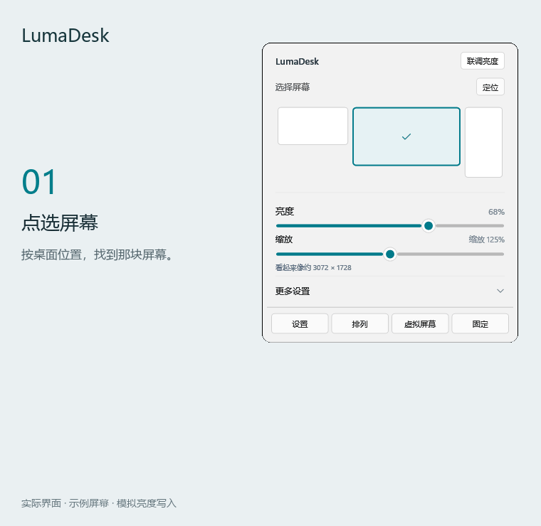
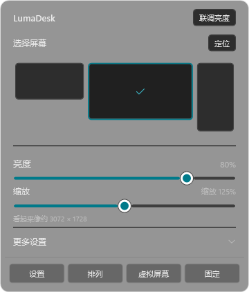
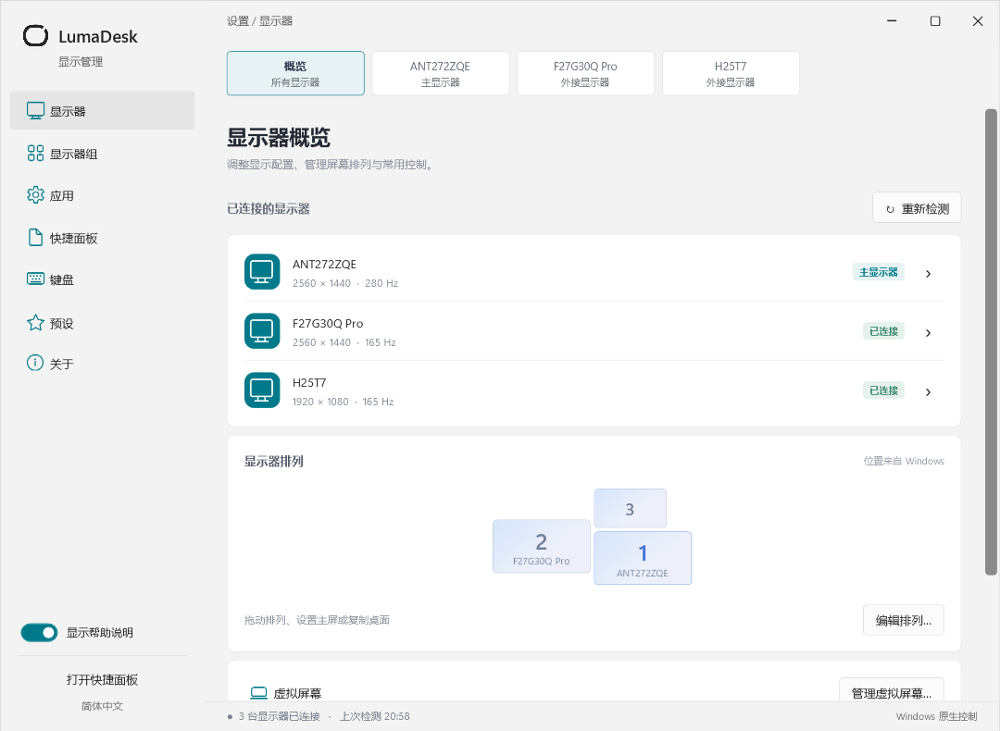

# LumaDesk

简体中文 · [English](README.en.md)

**在托盘里，管好你的每一块屏幕。**

LumaDesk 是一个开源 Windows 显示管理工具。调亮度、改缩放、切换屏幕配置，打开一个小面板就够了。

[下载预览版](https://github.com/Thweki/LumaDesk/releases) · [反馈问题](https://github.com/Thweki/LumaDesk/issues) · [构建状态](https://github.com/Thweki/LumaDesk/actions/workflows/build.yml)

## 看看它怎么用

按屏幕的位置点选，展开更多设置，再把几块屏幕的亮度一起调好。



<p>
  
  
</p>

## 平时用得上的功能

- **亮度顺手调**：背光与软件调暗衔接，支持单屏、多选联调和分组同步。
- **每块屏幕单独管**：缩放、分辨率、刷新率、旋转，以及设备支持的输入源、音量和对比度。
- **把桌面摆好**：拖动排列、设置主屏、扩展或复制桌面；保存成预设，下次一键切换。
- **更多显示工具**：HDR 开关、ICC 配置、虚拟屏幕和画中画。
- **融入日常使用**：快捷键、可选开机自启、深浅主题，支持简繁中文、英文、日文和韩文。



## 下载与上手

适用于 **Windows 10 / 11 x64**，自带 .NET 运行时。到 [Releases](https://github.com/Thweki/LumaDesk/releases) 选择一种下载：

| 文件 | 适合你，如果…… |
| --- | --- |
| `LumaDesk-版本-win-x64.exe` | 想直接运行，免安装 |
| `LumaDesk-版本-portable-win-x64.zip` | 想保留完整说明和许可文件，解压即用 |
| `LumaDesk-版本-win-x64.msi` | 想安装到 Program Files，并从开始菜单打开（需要管理员权限） |

1. 运行 `LumaDesk.exe`，单击托盘图标打开快捷面板，双击打开设置。
2. 在顶部点选屏幕，拖动亮度或 HiDPI 滑块；多屏一起调时，点击“联调亮度”。
3. 想保留当前配置，到“设置 → 预设”保存。开机自启和界面语言在“设置 → 应用”里。

默认快捷键：`Ctrl+Alt+↑ / ↓` 调整鼠标所在屏幕的亮度，`Ctrl+Alt+0` 移除软件调暗。

三个版本都把设置保存在 `%LOCALAPPDATA%\LumaDesk`；“便携版”指免安装，不会把设置写在程序旁。应用不收集遥测，虚拟驱动只在主动安装时下载。安装驱动或首次导入系统级 ICC 时，可能需要管理员授权。

## 下载前知道这些就够了

- HiDPI 使用 Windows 每屏缩放，不是全桌面超采样；部分旧应用仍可能模糊。
- DDC/CI、HDR、ICC 和输入源控制取决于显示器、连接方式及驱动；磨砂效果需要 Windows 11 22H2 或更新版本。
- 虚拟屏幕依赖单独安装的 [VirtualDrivers 驱动](https://github.com/VirtualDrivers/Virtual-Display-Driver)。
- 目前仍是预览版，硬件兼容性在持续验证。遇到问题欢迎附上显示器型号和连接方式：[验证记录](docs/validation.md)。

## 自己构建

需要 Windows 和 .NET 8 SDK。

```powershell
.\build.ps1 -Portable  # 构建自包含 EXE
.\test.ps1             # 完整测试，需要交互式桌面
.\package.ps1          # 生成 EXE、便携 ZIP、MSI 和 SHA256SUMS.txt
```

构建输出在 `artifacts/LumaDesk-win-x64/`，发行文件在 `artifacts/release/`。GitHub Actions 对提交和 PR 运行无桌面测试、打包和安装检查；推送版本标签后自动发布。见[发布说明](docs/releasing.md)。

进一步了解：[预设与自动化](docs/workflows.md) · [HDR / ICC](docs/color-hdr.md) · [屏幕排列](docs/display-layout.md) · [虚拟屏幕](docs/virtual-displays.md) · [添加翻译](docs/localization.md)

## 开源许可

0.4.0 起使用 [GPL-3.0-only](LICENSE)，0.3.1 及更早版本保留原 MIT 许可。第三方组件按各自许可分发，见 [NOTICE](NOTICE)。
